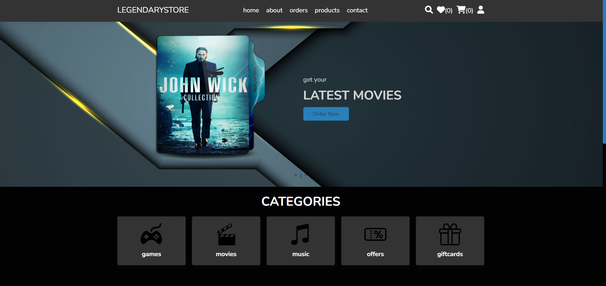
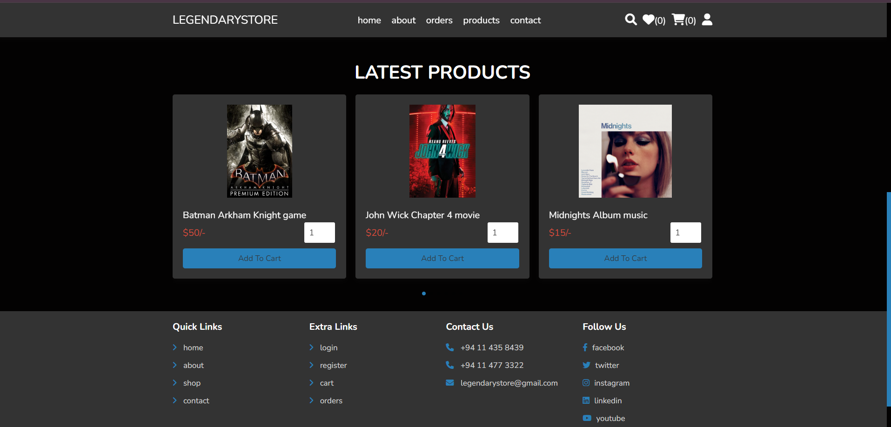
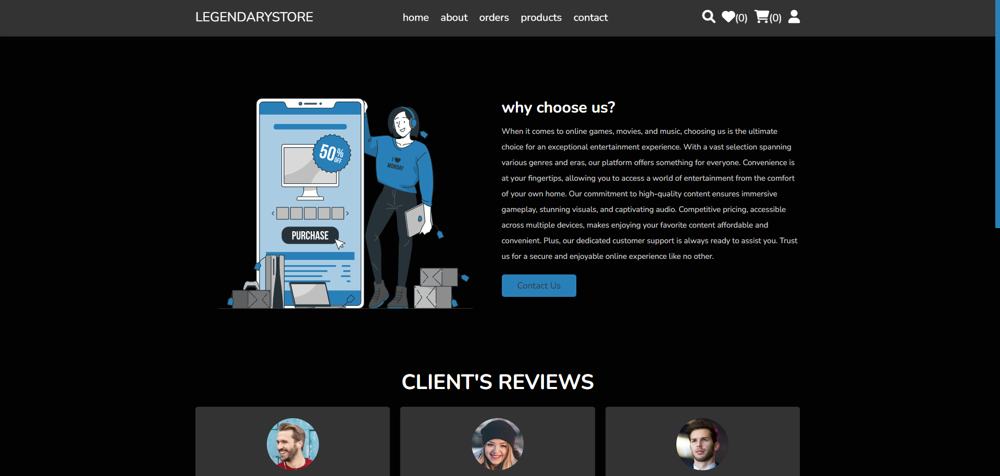
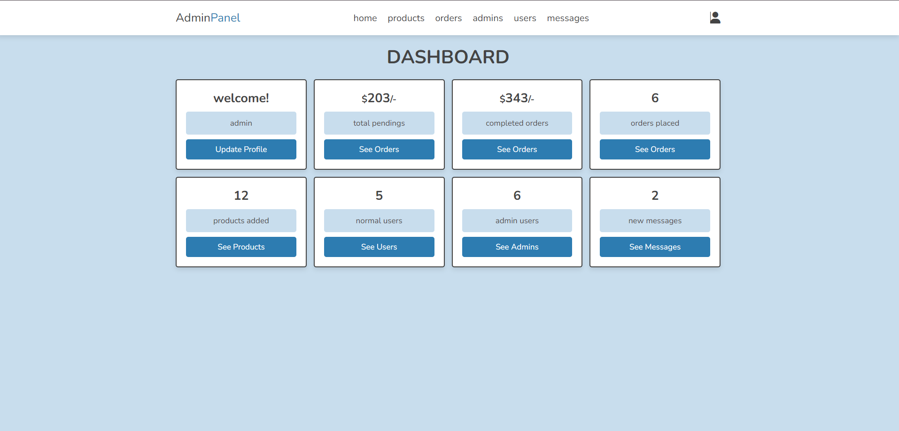
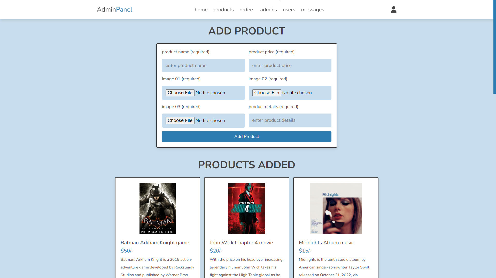
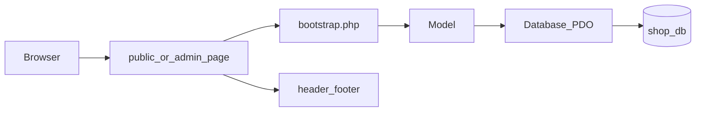
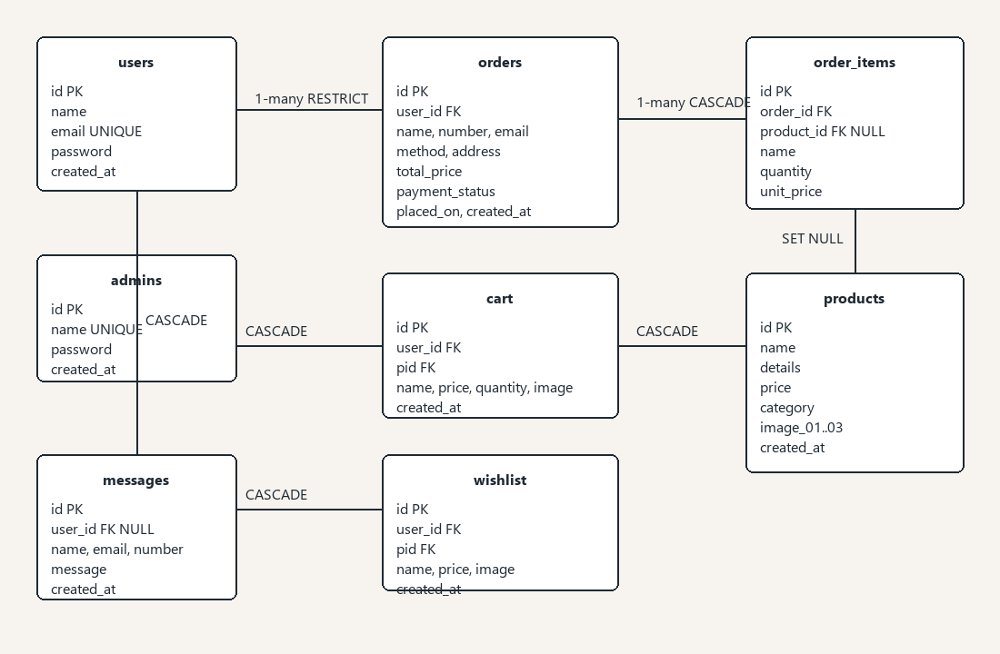

# LegendaryStore

LegendaryStore is a small PHP and MySQL shop for games, movies, music, and gift cards. It runs locally with XAMPP. Shoppers browse the catalog, keep a cart and a wishlist, and place orders. An admin account manages products, orders, messages, and accounts.

Topics: php, pdo, mysql, xampp, crud, ecommerce

## Screenshots







## Features

- Product catalog with category pages and search
- Cart and wishlist stored per user
- Checkout that saves each line item and its price at purchase time
- Customer registration, login, and profile update
- Contact form
- Admin dashboard for products, orders, messages, users, and admin accounts

## Tech stack

- PHP 8.1+ with PDO
- MySQL or MariaDB
- Apache via XAMPP
- Composer PSR-4 autoloading for the `App\` namespace

## Architecture

A request lands on a page in `public/` or `admin/`. The page loads `app/bootstrap.php`, calls a model, and renders a shared header and footer. Models are the only files that run SQL. `App\Database` is the only PDO connection.

See [docs/architecture.md](docs/architecture.md).



## Data model



`orders` keeps the buyer and the total. `order_items.unit_price` stores the price that was charged, so later product edits do not change old orders. Users have a unique email. Cart, wishlist, and message rows are removed with the user. Deleting a product clears cart and wishlist rows and leaves the order line in place with a null product id.

The diagram source is [docs/erd.svg](docs/erd.svg).

## Setup

Install [XAMPP](https://www.apachefriends.org/index.html) and [Composer](https://getcomposer.org/), then start Apache and MySQL.

Run these from the directory where you want the project, then run the last three inside the cloned folder:

```bash
git clone <repository-url> C:/xampp/htdocs/LegendaryStore
composer install
copy app/config/config.example.php app/config/config.php
mysql -u root -e "CREATE DATABASE IF NOT EXISTS shop_db CHARACTER SET utf8mb4 COLLATE utf8mb4_unicode_ci;" && mysql -u root shop_db < database/schema.sql && mysql -u root shop_db < database/seed.sql
```

On Windows PowerShell, run the MySQL imports as three statements if `&&` is not available:

```powershell
mysql -u root -e "CREATE DATABASE IF NOT EXISTS shop_db CHARACTER SET utf8mb4 COLLATE utf8mb4_unicode_ci;"
mysql -u root shop_db -e "source database/schema.sql"
mysql -u root shop_db -e "source database/seed.sql"
```

`source` paths are relative to the shell's current directory, so run them from the project folder. If the MySQL client is not on `PATH`, call `C:\xampp\mysql\bin\mysql.exe`.

Edit `app/config/config.php` when the database user or password is not `root` with an empty password. That file is gitignored.

Open the shop at <http://localhost/LegendaryStore/public>.

Open the admin login at <http://localhost/LegendaryStore/admin/login.php>. The seeded admin username is `admin`. The password is recorded only in a comment at the top of `database/seed.sql`.

## Known limitations / future work

- Payment method is stored as a label. The shop does not charge a card or call a payment provider.
- There is no email verification and no password-reset flow.
- The Apache document root is the project folder under `htdocs`. `app/`, `database/`, `docs/`, and `storage/` are blocked with `.htaccess`. A vhost whose document root is `public/`, with an alias for `admin/`, would match a production layout more closely.
- New files saved to `public/uploads/` stay out of git. The seeded catalog images are already tracked.
- Category `offer` is available in the admin form and has no seeded products yet.
