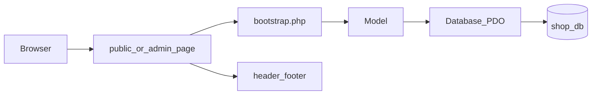

# Architecture

A browser request hits a page in `public/` or `admin/`. That page loads `app/bootstrap.php`, which starts the session, checks the CSRF token on POST, and registers an error handler that writes to `storage/app.log`.

The page calls a model. The model is the only place that runs SQL. `App\Database` opens one PDO connection from `app/config/config.php`. The page then includes `app/views/partials/header.php` and `footer.php` (admin pages use `admin_header.php` and `admin_footer.php`).

`app/`, `database/`, `docs/`, and `storage/` each contain an Apache `Require all denied` rule so those directories are not served when the project sits in `htdocs`. Uploaded product images live in `public/uploads/` and PHP files cannot be executed from that folder.

Checkout reads the cart in the database and copies each line into `order_items` with the price at purchase time. The total is calculated on the server.
